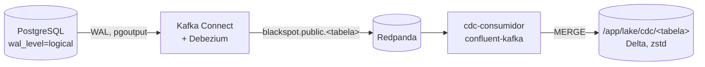

# Captura de mudanças (CDC)

Issue #32. Código em [`blackspot/cdc/`](../../blackspot/cdc/), serviços em
[`compose/cdc.yml`](../../compose/cdc.yml), testes em [`tests/test_cdc.py`](../../tests/test_cdc.py).
Contrato da E2 em [README.md](README.md); o papel do CDC na arquitetura está no
[ADR 0004](../adr/0004-ingestao-por-lote-incremental-em-delta.md): o lote é o caminho principal
da camada analítica, e o CDC é a **trilha de mudanças**, que pega também o que não cria lote novo.

## O que faz



Cada `INSERT`, `UPDATE` e `DELETE` confirmado em `lote_carga`, `ocorrencia`, `veiculo` e
`pessoa` vira um evento num tópico do Redpanda, e o consumidor grava os eventos numa **tabela
Delta por tabela capturada**, particionada por `ano`, com Parquet em zstd (as mesmas
propriedades de escrita do lote).

A tabela Delta é a **trilha de mudanças**, não o estado atual: cada linha é um evento, com as
colunas da tabela de origem e estas colunas de controle:

| Coluna | O que é |
|---|---|
| `_op` | `c` (insert), `u` (update), `d` (delete) ou `r` (linha do retrato inicial) |
| `_lsn` | posição do evento no WAL; com a chave primária, identifica o evento |
| `_tx_id` | transação do PostgreSQL |
| `_confirmado_em` | hora do commit no banco |
| `_capturado_em` | hora em que o Debezium leu o evento |
| `_gravado_em` | hora em que o consumidor gravou o evento no Delta (hora de processamento) |
| `_topico`, `_particao`, `_offset` | de onde o consumidor leu |

Decisões:

- **Retrato inicial só de `lote_carga`.** O histórico das outras tabelas (11 milhões de linhas)
  já chega à camada analítica pelo lote (#31). Por isso o conector só é registrado **depois da
  carga** (`cdc-conector` depende de `load`), e o CDC leva as mudanças daí em diante. O retrato
  de `lote_carga` (20 linhas) serve para o consumidor saber o ano de cada lote.
- **Partição pelo ano do lote.** O lote é o ano (ADR 0001), e toda tabela capturada tem
  `id_lote`, então o ano sai de `lote_carga` sem consultar a ocorrência. Fica igual ao ano do
  evento do contrato, porque a FK `(id_lote, ano)` garante que a ocorrência é do ano do lote.
- **Colunas geradas ficam de fora.** `ocorrencia.ano`, `ocorrencia.geom` e `lote_carga.sistema`
  não passam pelo WAL (o PostgreSQL 18 não as publica por padrão); quem precisar do ponto o
  recalcula de `latitude` e `longitude`.
- **No `DELETE`, só a chave.** O PostgreSQL só manda a chave primária no WAL. O Debezium
  preenche as outras colunas `NOT NULL` com `0` e `''`, e o consumidor as grava como nulas.
- **Tipos do próprio banco.** As mensagens vão sem esquema (JSON simples), e o consumidor tira
  colunas e tipos do `information_schema`, com o mesmo mapeamento do lote. `numeric` vem como
  texto (`decimal.handling.mode=string`) para não perder casas decimais.
- **Tópicos sem expiração**, com uma partição cada (ordem total por tabela), para o consumidor
  poder reprocessar do início.

O estado atual de uma tabela sai da trilha pegando o último evento de cada chave. Exemplo com
DuckDB, para `lote_carga`:

```sql
SELECT * EXCLUDE (rn) FROM (
  SELECT *, row_number() OVER (PARTITION BY id_lote ORDER BY _lsn DESC) AS rn
  FROM delta_scan('/app/lake/cdc/lote_carga'))
WHERE rn = 1 AND _op <> 'd';
```

## Como rodar

Faz parte do `docker compose up`: `redpanda` e `connect` sobem com o banco; depois da carga,
`cdc-conector` registra o conector e termina; `cdc-consumidor` fica rodando.

```bash
docker compose up --build -d
docker compose wait cdc-conector                     # conector registrado e RUNNING
docker compose logs -f cdc-consumidor                # um lote de mensagens por linha
docker compose exec redpanda rpk topic list          # tópicos blackspot.public.*
docker compose exec redpanda rpk group describe blackspot-cdc   # offsets e atraso
```

Registrar o conector de novo é idempotente (`PUT /connectors/<nome>/config`). O Redpanda tem
volume próprio (`redpanda`): os offsets do Debezium precisam andar junto com o slot de
replicação do PostgreSQL. Apagar só um dos dois volumes (`pgdata` ou `redpanda`) deixa os dois
fora de sincronia; para recomeçar do zero, use `docker compose down -v`.

## Script de mudança: republicação simulada

[`blackspot/cdc/mudanca.py`](../../blackspot/cdc/mudanca.py) simula a PRF republicando um ano,
como a carga faria: numa transação, cria um lote novo com uma cópia do lote vigente do ano,
com **5 ocorrências com o km corrigido** (+0,1) e **uma ocorrência a menos** (com os veículos,
pessoas, causas e tipos dela). Espera os eventos chegarem no Delta, mostra as linhas alteradas
lá e, no fim, **desfaz**: apaga o lote inventado, para não deixar dado falso como versão
vigente. Os `DELETE`s também atravessam o fluxo. Com `--manter`, o lote fica.

```bash
docker compose run --rm cdc-demo          # = python -m blackspot.cdc.mudanca republicar
```

O padrão é 2026, o menor ano (é parcial, e é também o que a PRF regrava todo mês). Saída de
2026-10-16:

```text
republicação simulada de 2026 (lote vigente: 21)
  lote 84 gravado em 14.0 s: 263977 mudanças nas tabelas capturadas (lote_carga 1, ocorrencia 48710, veiculo 94345, pessoa 120920, e o UPDATE de lote_carga)
  alterado: km de 5 ocorrência(s); removida: ocorrência 742892

esperando os eventos chegarem no Delta...
  lote_carga           completa no Delta    2.2 s depois do commit
  ocorrencia           completa no Delta   16.1 s depois do commit
  veiculo              completa no Delta   23.3 s depois do commit
  pessoa               completa no Delta   31.7 s depois do commit
  lote_carga (UPDATE)  completa no Delta   32.4 s depois do commit
  vazão: 8147 eventos/s

no Delta (/app/lake/cdc/ocorrencia, ano=2026, id_lote=84):
  ocorrência 742884: km 145.0 no lote 21 -> 145.1 no lote 84
  ocorrência 742885: km 639.3 no lote 21 -> 639.4 no lote 84
  ocorrência 742888: km 108.0 no lote 21 -> 108.1 no lote 84
  ocorrência 742889: km 174.4 no lote 21 -> 174.5 no lote 84
  ocorrência 742891: km 164.0 no lote 21 -> 164.1 no lote 84
  ocorrência 742892: AUSENTE no lote 84

desfazendo: apagando o lote 84
  263976 DELETEs no Delta 28.2 s depois do commit; o lote vigente de 2026 voltou a ser o 21
```

A republicação de um ano inteiro chega como **um bloco de 264 mil eventos numa transação**: o
Debezium só publica depois do commit, e o consumidor grava ~8 mil eventos por segundo. É o
custo que o ADR 0004 aponta para o CDC como caminho principal: para essa mudança, o lote
reescreve as partições do ano em 3,3 s.

## Semântica de entrega

**Pelo menos uma vez na leitura, sem duplicata na gravação** (na prática, efeito de
exatamente uma vez na tabela Delta):

- O consumidor confirma o offset no Redpanda (`enable.auto.commit=false`) **só depois** de
  gravar o lote de mensagens no Delta. Se cair entre as duas coisas, as mesmas mensagens são
  relidas quando ele voltar. Nada se perde.
- A gravação é um **`MERGE` pela chave do evento** (`_lsn` + chave primária), que só insere o
  que ainda não está na tabela. Mensagem relida, por queda do consumidor, por reprocessamento
  ou por reenvio do próprio Debezium depois de reiniciar (que também é pelo menos uma vez), não
  vira linha nova. A chave é a posição no WAL, e não o offset do Redpanda, porque um reenvio do
  Debezium cai em offsets novos com o mesmo LSN.

[`blackspot/cdc/semantica.py`](../../blackspot/cdc/semantica.py) demonstra as duas coisas. Ele
faz o papel do consumidor, então o serviço precisa estar parado:

```bash
docker compose stop cdc-consumidor
docker compose run --rm cdc-demo python -m blackspot.cdc.semantica
docker compose start cdc-consumidor
```

Saída de 2026-10-16 (sem as linhas de cada lote de mensagens):

```text
1. tabelas Delta do CDC antes: lote_carga 92, ocorrencia 194840, veiculo 377380, pessoa 483680
2. duas mudanças no banco (INSERT e DELETE em lote_carga)
  lote 117: 2 eventos no tópico; não confirmados pelo grupo: {'lote_carga': 2, 'ocorrencia': 0, 'veiculo': 0, 'pessoa': 0}
3. consumidor cai depois de gravar no Delta e antes de confirmar o offset
  lote_carga      2 evento(s),      2 inserido(s), latência até 1.99 s
  não confirmados pelo grupo depois da queda: {'lote_carga': 2, 'ocorrencia': 0, 'veiculo': 0, 'pessoa': 0}
4. consumidor volta: relê o que não foi confirmado
  lote_carga      2 evento(s),      0 inserido(s), latência até 3.02 s
  => retomada: 2 evento(s) lido(s), 0 inserido(s) no Delta
5. reprocessamento dos tópicos desde o primeiro evento
  => reprocessamento: 1055994 evento(s) lido(s), 0 inserido(s) no Delta
6. conferência
  lote_carga antes      92, depois      94 (esperado 94), eventos distintos      94 ok
  ocorrencia antes  194840, depois  194840 (esperado 194840), eventos distintos  194840 ok
  veiculo    antes  377380, depois  377380 (esperado 377380), eventos distintos  377380 ok
  pessoa     antes  483680, depois  483680 (esperado 483680), eventos distintos  483680 ok
sem a gravação idempotente, a retomada e o reprocessamento teriam duplicado 1055996 linha(s).
```

Depois da queda (passo 3), os 2 eventos **já estão no Delta, mas o Redpanda ainda os conta como
não lidos**. Na volta, são relidos, e o `MERGE` não insere nada. O reprocessamento relê o
milhão de eventos dos tópicos (as republicações de 2026 rodadas durante o desenvolvimento) e
também não insere nada. Com um `append` simples no lugar do `MERGE`, as
tabelas teriam 1.055.996 linhas repetidas.

A tabela também foi **reconstruída do zero a partir dos tópicos**: com `/app/lake/cdc` apagado,
`python -m blackspot.cdc.consumidor --do-inicio --ate-em-dia` regravou os 527.975 eventos
existentes na época em 40 s.

## Latência

Medida com mudanças de uma linha: cada amostra insere em `lote_carga` um lote com status
`falhou` (não muda a versão vigente), espera chegar no Delta, apaga e espera de novo.

```bash
docker compose run --rm cdc-demo python -m blackspot.cdc.mudanca latencia --amostras 30
```

Medido em 2026-10-16, numa máquina só (PostgreSQL 18.6, Debezium 3.3.1, Redpanda 25.2.9,
deltalake 1.6.6), 60 mudanças:

| Do commit no banco até... | Mediana | p95 | Mínimo | Máximo |
|---|---|---|---|---|
| a mudança visível numa leitura do Delta (medido por fora) | **1,23 s** | 1,73 s | 0,53 s | 2,02 s |
| a gravação pelo consumidor (`_gravado_em − _confirmado_em`) | 0,75 s | 1,11 s | 0,22 s | 1,18 s |

A diferença entre as duas linhas é o próprio `MERGE` mais o intervalo de consulta de quem mede.
Para mudanças em bloco, a latência é dominada pela vazão: a republicação de 2026 (264 mil
eventos) fica inteira no Delta **32 s** depois do commit.

## Testes

Em [`tests/test_cdc.py`](../../tests/test_cdc.py), no serviço `tests`:

- **Sem infraestrutura:** conversão dos eventos do Debezium (tipos, `DELETE` só com a chave,
  ano do lote em vez do `0` que o Debezium preenche) e gravação idempotente (reler os mesmos
  eventos em outros offsets não insere nada; evento repetido no mesmo lote de mensagens; INSERT
  e DELETE da mesma chave são eventos diferentes; partição pelo ano).
- **Sobre as tabelas do CDC:** nenhum evento repetido nas quatro tabelas, e o estado de
  `lote_carga` reconstruído da trilha (último evento de cada chave, por LSN) é igual ao do banco.
- **Fluxo:** confirma uma linha em `lote_carga` e espera o `INSERT` e o `DELETE` chegarem no
  Delta (até 60 s cada). Precisa do `cdc-consumidor` rodando.

```bash
docker compose up --build -d && docker compose wait cdc-conector ingestao-lote
docker compose run --rm tests        # 118 testes, 11 do CDC
```

## Limites

- **Arquivos pequenos.** Cada lote de mensagens grava um arquivo por partição tocada; uma
  mudança de uma linha vira um arquivo Parquet. Não há compactação automática:
  `DeltaTable(...).optimize.compact()` junta os arquivos (e o `VACUUM` apaga os antigos, com o
  mesmo custo para a viagem no tempo descrito no ADR 0004).
- **Slot de replicação.** Com o Debezium parado, o PostgreSQL retém WAL até ele voltar
  (`max_slot_wal_keep_size` está no padrão, sem limite). O heartbeat a cada 10 s evita reter
  WAL quando só tabelas fora da publicação mudam.
- **Usuário do conector.** O Debezium usa o usuário do banco (superusuário em desenvolvimento)
  e cria a publicação sozinho. Em produção seria um usuário só com `REPLICATION` e `SELECT`.
- **Mudança de esquema.** As colunas são lidas do banco quando o consumidor sobe. Uma coluna
  nova exige reiniciar o consumidor, e o `MERGE` atual não acrescenta coluna numa tabela Delta
  que já existe.
- **Ordem entre tabelas.** Cada tabela tem um tópico, e a ordem é garantida só dentro dele. Os
  eventos de uma transação podem chegar ao Delta de `pessoa` antes de chegarem ao de
  `ocorrencia`; `_tx_id` e `_lsn` permitem remontar a transação.
