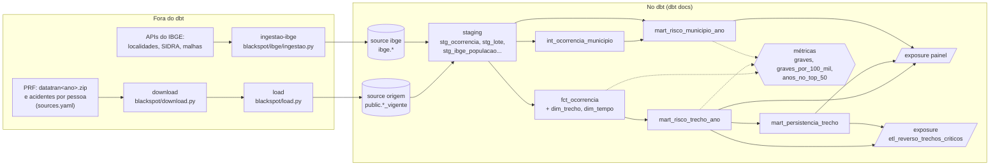

# Catálogo e linhagem

Parte da E4 da issue #53. O contrato entre as partes está no [README.md](README.md); as métricas,
em [`metricas.md`](metricas.md).

**Catálogo** é a descrição de cada tabela e coluna: o que é, de onde vem e como foi calculada.
**Linhagem** é o caminho que o dado faz, do arquivo público até quem o usa. No BlackSpot, os dois
ficam no próprio dbt e aparecem no `dbt docs`, uma página web gerada a partir do projeto.

## Como abrir o catálogo

```bash
docker compose run --rm -p 8080:8080 --entrypoint sh dbt \
  -c "dbt docs generate && dbt docs serve --host 0.0.0.0 --port 8080 --no-browser"
```

Depois, abra **http://localhost:8080**. O `docs generate` lê o banco (o tipo e o número de linhas
de cada tabela), então rode antes o `dbt build`.

- **Catálogo:** no menu da esquerda, cada fonte, modelo, métrica e exposure tem a descrição e as
  colunas. As tabelas que o painel lê têm todas as colunas descritas.
- **Linhagem:** o botão azul no canto de baixo, à direita (*View Lineage Graph*), mostra o grafo.
  Com `+exposure:painel` no campo de seleção, o grafo mostra só o que chega ao painel.

As mesmas descrições também vão para o banco como `COMMENT` (configuração `persist_docs` nos
`.yml` dos marts). Quem consulta pelo `psql` vê o mesmo texto: `\d+ analitico_marts.mart_persistencia_trecho`.

## Da fonte pública ao consumo



O dbt começa nas **fontes** (`sources`), que são as tabelas que a carga gravou no banco. O que
vem antes delas não é do dbt, mas está declarado nos `.yml` das fontes, e aparece no catálogo:
o produtor, a página e o dicionário da PRF, as URLs das APIs do IBGE e qual programa grava cada
tabela (`loader`). O dbt termina nas **exposures**, que dizem quem consome as tabelas: o painel e
o ETL reverso, cada um com as tabelas de que depende e com a sua dona.

| Trecho do caminho | Onde está | Aparece no `dbt docs` |
|---|---|---|
| Arquivo da PRF → volume `rawdata` | [`blackspot/download.py`](../../blackspot/download.py), [`sources.yaml`](../../sources.yaml) (um ZIP por ano, com o sha256) | no `meta` da fonte `origem` |
| ZIP → `public.ocorrencia`, `pessoa`, `veiculo` (um lote por carga) | [`blackspot/load.py`](../../blackspot/load.py), [`db/migrations/`](../../db/migrations/) | no `loader` e na descrição de cada coluna da fonte |
| APIs do IBGE → `ibge.municipio`, `populacao`, `malha_municipal` | [`blackspot/ibge/ingestao.py`](../../blackspot/ibge/ingestao.py) | no `meta.api` de cada tabela da fonte `ibge` |
| Fonte → staging → marts | [`dbt/models/`](../../dbt/models/) | no grafo de linhagem |
| Marts → painel | [`painel/app.py`](../../painel/app.py) | exposure `painel` |
| Marts → ETL reverso | `orquestracao/` (asset `etl_reverso_trechos_criticos`), [ADR 0006](../adr/) | exposure `etl_reverso_trechos_criticos` |

## O caminho de uma coluna do painel até a origem

### "Anos no top 50", na aba "Trechos mais graves"

A tabela "Os trechos que se mantêm" do painel mostra, para cada trecho, em quantos anos ele
ficou entre os 50 mais graves. De trás para a frente:

| # | Onde | Coluna | O que acontece |
|---|---|---|---|
| 1 | painel | `anos_no_top` | lê a coluna, sem calcular nada (ver a nota abaixo) |
| 2 | `mart_persistencia_trecho` | `anos_no_top_50` | conta os anos com `no_top_50 = true` do trecho |
| 3 | `mart_risco_trecho_ano` | `no_top_50` | `posicao <= 50` (macro `metrica_no_top_50`) |
| 4 | `mart_risco_trecho_ano` | `posicao` | `rank()` do trecho no ano pelo número de `graves` |
| 5 | `mart_risco_trecho_ano` | `graves` | conta os acidentes com `grave` do trecho no ano |
| 6 | `fct_ocorrencia` | `grave`, `chave_trecho` | `mortos > 0 or feridos_graves > 0` (macro `metrica_grave`); trecho = BR + UF + `floor(km / 10) * 10` |
| 7 | `stg_ocorrencia` | `mortos`, `feridos_graves`, `br`, `uf`, `km` | passam sem mudança de valor (só a versão vigente) |
| 8 | fonte `origem.ocorrencia_vigente` | as mesmas | view: as linhas de `public.ocorrencia` do lote vigente de cada ano |
| 9 | `blackspot/load.py` | as mesmas | lê o CSV, converte o km com vírgula decimal e rejeita a linha que não cabe no esquema |
| 10 | `datatran<ano>.zip` da PRF | `mortos`, `feridos_graves`, `br`, `uf`, `km` | o arquivo público, baixado pelo endereço do `sources.yaml` |

Na `main`, o painel ainda calcula este número sozinho, com o `rank()` sobre a
`mart_risco_trecho_ano`. A troca para ler a `mart_persistencia_trecho` é da parte do painel
(#52). O teste `metrica_anos_no_top_50_bate_com_painel` prova que a consulta antiga e a tabela
nova dão o mesmo número, trecho a trecho, e por isso a troca não muda o que o painel mostra.

### "Graves por 100 mil habitantes", na aba "Municípios mais perigosos"

| # | Onde | Coluna | O que acontece |
|---|---|---|---|
| 1 | painel | "graves_por_100_mil" | lê a coluna |
| 2 | `mart_risco_municipio_ano` | `graves_por_100_mil` | `round(graves * 100000 / populacao, 2)` (macro `metrica_graves_por_100_mil`) |
| 3a | `mart_risco_municipio_ano` | `graves` | conta os acidentes graves (macro `metrica_grave`) ligados ao município |
| 4a | `int_ocorrencia_municipio` | `cod_municipio` | liga o acidente ao município pela coordenada, pelo nome ou pelo nome antigo |
| 5a | `stg_ocorrencia` → fonte `origem` → `datatran<ano>.zip` | `mortos`, `feridos_graves`, `municipio`, `geom` | como no caminho acima |
| 3b | `mart_risco_municipio_ano` | `populacao` | a do mesmo ano ou, sem ela, a do ano mais próximo |
| 4b | `stg_ibge_populacao` → fonte `ibge.populacao` | `populacao` | passa sem mudança |
| 5b | `blackspot/ibge/ingestao.py` → API SIDRA do IBGE | variável 9324 (estimativa) ou 93 (censo) | uma consulta por ano |

No `dbt docs`, os passos 2 a 8 são o grafo de linhagem da coluna, e cada coluna tem a descrição
de onde veio. Os passos 9 e 10 ficam no `meta` e na descrição das fontes.

## O que ficou de fora

- **Linhagem coluna a coluna automática.** O `dbt docs` do dbt-core mostra a linhagem por
  tabela, e não por coluna. O caminho de cada coluna está nas descrições e nas tabelas acima.
- **O que acontece antes do banco** (download e carga) não é um nó do grafo, porque o dbt não o
  executa. Ele está na descrição das fontes. No Dagster (`docs/e3/orquestracao.md`), os assets
  `arquivos_prf`, `origem_prf` e `base_ibge` são essa parte do caminho.
