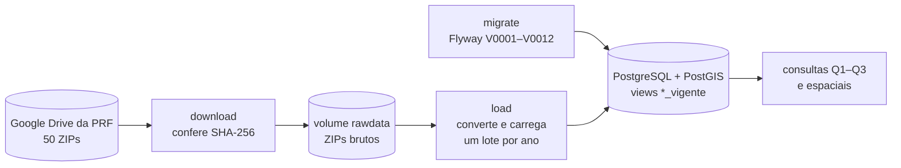

# Release Notes 1 — Banco de Dados 2

- **Nome do grupo:** Squad BlackSpot
- **Integrantes:** Ana Luiza Komatsu (231011079), Cibelly Lourenço (231026680), Maria Clara Sena (231012281)
- **Data:** 13/10/2026
- **Domínio:** segurança viária nas rodovias federais brasileiras (acidentes registrados pela PRF)
- **Versão:** tag [`r1`](https://github.com/cibelinda/Engenharia-Dados-Seguranca-Viaria/tree/r1). Substitui a tag `e1` (28/09/2026) e inclui as correções feitas a partir da avaliação da E1.

---

## 1. Domínio, perguntas e valor de negócio

**Domínio de aplicação:**
A Polícia Rodoviária Federal registra cada acidente nas rodovias federais e publica esses
registros como dados abertos desde 2007. O problema é encontrar os *black spots* ("pontos
negros"), os trechos onde os acidentes graves se concentram ano após ano, para separar o problema
estrutural da via do acidente isolado. Os dados não chegam prontos: vêm de dois sistemas de
registro com formatos diferentes (BR-Brasil até 2016 e BAT a partir de 2017), e a PRF regrava os
arquivos sem aviso, inclusive de anos já fechados.

**Pergunta de gestão:**

> Quais trechos de 10 km das rodovias federais concentraram mais acidentes com mortos ou feridos
> graves entre 2007 e 2025, e esses trechos se mantêm de um ano para o outro?

**Perguntas que o projeto pretende responder** (desdobramentos da pergunta de gestão):

1. **P1.** Quais trechos de 10 km (BR + UF + km) tiveram mais acidentes com morto ou ferido grave
   em cada ano, de 2007 a 2025?
2. **P2.** Em quantos dos 19 anos cada trecho ficou entre os mais graves do ano? Essa
   persistência separa o ponto negro da flutuação de um ano só.
3. **P3.** Nos trechos mais graves, a partir de 2017, em que ponto (raio de até 2 km) os
   acidentes graves se concentram?

**Valor de negócio dos dados gerados:**
Os dados servem a quem decide onde intervir na malha federal: a PRF, para direcionar
fiscalização e policiamento, e o DNIT e as concessionárias, para priorizar obras de engenharia
(sinalização, correção de curva, travessia urbana). A decisão que eles apoiam é *onde gastar
primeiro*. Medir gravidade, e não quantidade de acidentes, põe no topo os trechos onde há morte e
lesão grave. A persistência evita gastar em um trecho que só teve um ano ruim. O histórico de
versões, por sua vez, mostra se a resposta mudou porque a PRF revisou os dados.

[Detalhes da pergunta e do recorte](pergunta-e-recorte.md)

## 2. Fontes de dados

| Fonte | Link | Formato | Pergunta(s) que apoia |
|---|---|---|---|
| PRF: acidentes agrupados por ocorrência (`datatranAAAA`), 2007–2026 | [Dados Abertos da PRF](https://www.gov.br/prf/pt-br/acesso-a-informacao/dados-abertos/dados-abertos-da-prf) | ZIP com CSV (`;` ou `,`, cp1252), no Google Drive | P1, P2, P3 |
| PRF: acidentes agrupados por pessoa (`acidentesAAAA`), 2007–2026 | mesma página | ZIP com CSV | P1 e P2 (confere `mortos` e `feridos_graves` com as pessoas) |
| PRF: todas as causas e tipos (`acidentesAAAA_todas_causas_tipos`), 2017–2026 | mesma página | ZIP com CSV | Contexto dos trechos graves (E3) |
| Dicionário de dados da PRF | [Dicionário](https://www.gov.br/prf/pt-br/acesso-a-informacao/dados-abertos/dicionario-acidentes) | PDF | Documentação |

São 50 arquivos, cerca de 370 MB compactados. Cada um tem ID do Google Drive e SHA-256 de
referência no manifesto [`sources.yaml`](../sources.yaml). O reconhecimento da fonte está em
[Fonte de dados](fontes/README.md).

## 3. Escolha do banco de dados

**Banco escolhido:** PostgreSQL 18.6 com a extensão espacial PostGIS 3.6 (imagem `postgis/postgis:18-3.6`).

**Principais argumentos:**
- **Workload:** escrita em lote (o arquivo do ano inteiro, quando a PRF republica) e leitura
  analítica, que agrega por trecho e ano e varre o histórico. Não há escrita linha a linha nem
  consulta em tempo real. A latência tolerada é de meses, porque a pergunta é anual
  ([caracterização da carga](caracterizacao-da-carga.md)).
- **Modelo de dados espacial:** desde 2017, todo acidente tem latitude e longitude. O PostGIS
  guarda o ponto como `geometry(Point, 4674)` (SIRGAS 2000), com índice GiST. "Acidentes graves num
  raio de 2 km" leva 46 ms, contra 608 ms com a fórmula de haversine sem índice, com a mesma
  resposta ([ADR 0002](adr/0002-banco-espacial-postgis.md)).
- **Modelo de dados relacional:** ocorrência, veículo e pessoa têm relações 1:N com integridade
  garantida pelo banco (PKs, FKs, CHECKs). A carga de um ano é uma transação: falhou, nada fica.
  O histórico é insert-only, versionado por lote ([ADR 0001](adr/0001-modelo-normalizado-insert-only-versionado-por-lote.md)).
- **Volume e operação:** 2,2 milhões de acidentes e 2,7 GB cabem com folga num servidor
  PostgreSQL. Tudo é código aberto, sobe com Docker Compose e tem migrações versionadas com Flyway.
- **Alternativas descartadas:** PostgreSQL sem extensão (sem tipo nem índice espacial; foi a
  escolha da E1, corrigida), MongoDB (perde FKs, transação por lote e funções espaciais de
  agrupamento), DuckDB spatial (embarcado, não é fonte transacional) e TimescaleDB ou Neo4j (a
  pergunta não é de série temporal densa nem de grafo).

➡️ ADRs completos:
- [ADR 0002 — Escolha do banco: PostgreSQL com PostGIS](adr/0002-banco-espacial-postgis.md)
- [ADR 0001 — Modelagem da origem: normalizada, insert-only, versionada por lote](adr/0001-modelo-normalizado-insert-only-versionado-por-lote.md)
- [ADR 0003 — Dataset completo: BR-Brasil e BAT no mesmo esquema](adr/0003-dataset-completo-br-brasil-e-bat.md)

## 4. Pipeline de dados (versão inicial)

**Diagrama:** [Arquitetura e modelos](arquitetura-e-modelos.md#arquitetura-e-pipeline), com o
pipeline e os modelos conceitual, lógico e físico.



**Etapas:**

| Etapa | O que faz | Ferramenta / script |
|---|---|---|
| Ingestão | Baixa os 50 arquivos do Google Drive da PRF, em paralelo, e confere o SHA-256 de cada um contra o manifesto. Um arquivo republicado gera aviso e é registrado, sem parar o pipeline | [`blackspot/download.py`](../blackspot/download.py), [`sources.yaml`](../sources.yaml), serviço `download` |
| Armazenamento bruto | Os ZIPs ficam como a PRF publicou, no volume Docker `rawdata` (`data/raw/`), com um relatório de download (`_download_report.json`) | volume `rawdata` |
| Transformação | Só a necessária para o dado caber no esquema: separador, três formatos de data, decimal com vírgula ou ponto, `(null)`/`NA` → `NULL`, coordenada inválida → `NULL`. Linhas que não cabem vão para `linha_rejeitada` com o motivo. A harmonização entre os sistemas (`Morto` × `Óbito`) fica para a E3 | [`blackspot/load.py`](../blackspot/load.py) |
| Carga | Um ano por vez, numa transação, com `COPY`. Cada ano vira um lote em `lote_carga`, e um ano só é recarregado quando o SHA-256 de algum arquivo dele muda. O lote anterior é preservado (insert-only) | [`blackspot/load.py`](../blackspot/load.py), [`db/migrations/`](../db/migrations/), serviços `migrate` e `load` |
| Consumo | SQL sobre as views `*_vigente` (versão mais recente de cada ano): ranking de trechos, persistência e consultas espaciais (`ST_DWithin`, `ST_ClusterDBSCAN`) | [Caracterização da carga](caracterizacao-da-carga.md), `psql` |

**Status atual:**

O que já roda, com um único `docker compose up --build`:
- os 50 arquivos de 2007 a 2026 baixados e conferidos;
- o esquema criado do zero por 12 migrações;
- a carga de 2.243.584 ocorrências, 4.008.904 veículos, 4.998.779 pessoas, 934.079 causas e
  1.051.668 tipos (1.275 linhas rejeitadas, todas com motivo), em cerca de 8 minutos. O banco
  ocupa 2,7 GB;
- rodar de novo não duplica nada, e uma republicação vira lote novo;
- 99 testes automatizados (`docker compose run --rm tests`) de esquema, volume, distribuição,
  dado faltante e reprocessamento.

O que está previsto:
- **E2:** captura de mudanças da fonte. A PRF regrava arquivos no mesmo endereço, e a comparação
  direta entre versões está agendada para 26/10/2026.
- **E3:** transformações e harmonização dos vocabulários dos dois sistemas; calibrar o tamanho do
  trecho e o critério de persistência; tratar as coordenadas padrão repetidas (metade dos
  acidentes de 2019 a 2024); verificar a quebra de volume na troca de sistema (2016/2017).
- **Consumo:** painel ou relatório com os trechos persistentes.

## Mudanças desde a E1

Correções feitas a partir da avaliação da E1 (12/10/2026):

| Feedback | O que mudou |
|---|---|
| O banco não era apropriado para dados com latitude e longitude | PostgreSQL com **PostGIS**: coluna `geom` gerada das coordenadas, em SIRGAS 2000, com índice GiST ([ADR 0002](adr/0002-banco-espacial-postgis.md), migração `V0009`) |
| O BR-Brasil não podia ser descartado só por estar em outro formato | **Dataset completo**, 2007–2026: os dois sistemas no mesmo esquema, com o formato tratado na carga. O volume foi de 632 mil para 2,2 milhões de acidentes ([ADR 0003](adr/0003-dataset-completo-br-brasil-e-bat.md), migrações `V0010`–`V0012`) |
| — | Causas e tipos de cada acidente do BAT em `ocorrencia_causa` e `ocorrencia_tipo` |
| — | [Caracterização da carga](caracterizacao-da-carga.md) e medição do [ADR 0001](adr/0001-modelo-normalizado-insert-only-versionado-por-lote.md) refeitas sobre o dataset completo. O volume disparou dois gatilhos de revisão do ADR 0001 (banco acima de 2 GB, Q2 acima de 2 s); a decisão foi reavaliada, se mantém e tem gatilhos recalibrados |

As migrações da E1 (`V0001`–`V0008`) não foram editadas: um banco da E1 chega ao esquema novo só
aplicando as quatro novas.

## Como rodar

```bash
git clone https://github.com/cibelinda/Engenharia-Dados-Seguranca-Viaria.git
cd Engenharia-Dados-Seguranca-Viaria
docker compose up --build        # termina com "load-1 exited with code 0" (~13 min do zero)
```

Instruções completas, conferência e problemas comuns: [README](../README.md#como-subir-o-projeto).
