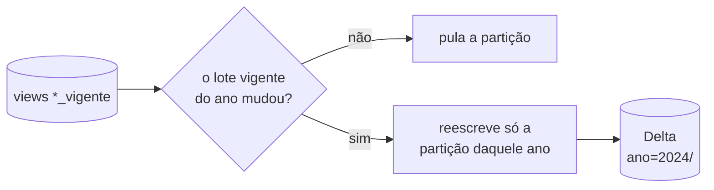
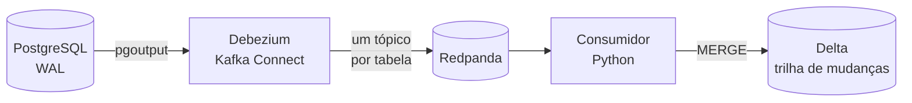

# Camada analítica

O PostgreSQL é a fonte transacional. Para a análise, os dados vão para **tabelas Delta em
Parquet**, um formato aberto que qualquer ferramenta lê sem o banco (DuckDB, Spark, pandas). Dois
caminhos alimentam essa camada: o **lote incremental**, que é o principal, e a **captura de
mudanças (CDC)**, que pega o que o lote não vê.

  
2,7 GB → 138 MBdo banco para Delta, Parquet e zstd

  
3,3 spara levar a republicação de um ano à camada

  
~1 slatência do CDC, do commit até o Delta

  
0linhas duplicadas ao reprocessar 1,58 milhão de eventos

## Lote incremental

Lê a versão vigente do banco e grava uma tabela Delta para ocorrência, veículo, pessoa, causas e
tipos, **particionada pelo ano do acidente**, com um arquivo Parquet por partição.

- **Idempotente:** a primeira execução grava 80 partições em 94 s; a segunda, sem mudança na
  origem, não grava nada e termina em 10 s.
- **Dado atrasado:** quando a PRF republica um ano fechado, o dado cai na partição do **ano do
  evento**, e não do dia da ingestão. Só aquela partição é reescrita: 5 de 80, em 3,3 s, sem
  duplicar.
- **Viagem no tempo:** a versão anterior da partição continua no histórico da tabela Delta e pode
  ser lida pelo número da versão.
- **Retrato consistente:** a leitura inteira acontece numa única transação, então todas as tabelas
  saem do mesmo momento do banco, mesmo com uma carga terminando no meio.

| Tabela | Linhas | Tamanho em Parquet (zstd) |
|---|---|---|
| ocorrência | 2.243.584 | 52,9 MB |
| veículo | 4.008.904 | 31,8 MB |
| pessoa | 4.998.779 | 47,1 MB |
| causas | 934.079 | 3,2 MB |
| tipos | 1.051.668 | 3,3 MB |
| **Total** | **13,2 milhões** | **138 MB** |

## Captura de mudanças (CDC)

O lote só percebe uma mudança quando ela cria um lote novo. Uma correção feita direto no banco não
cria. Para isso existe o CDC: cada `INSERT`, `UPDATE` e `DELETE` confirmado vira um evento.

Cada linha da tabela Delta é um evento, com a operação, a posição no WAL e três horários: o commit
no banco, a leitura pelo Debezium e a gravação no Delta.

### Uma republicação atravessando o fluxo

Um script simula a PRF republicando 2026: cria um lote novo com o km corrigido em 5 acidentes e um
acidente a menos, numa transação.

| | Resultado |
|---|---|
| Eventos gerados | 264 mil, numa transação |
| Tudo no Delta | 30 a 40 s depois do commit (7 a 8 mil eventos/s) |
| No Delta | os 5 km corrigidos no lote novo, e o acidente removido ausente |
| Desfazer | os 264 mil `DELETE`s também atravessam o fluxo |

### Entrega garantida, sem duplicata

**Pelo menos uma vez na leitura, idempotente na gravação.** O consumidor só confirma a leitura no
Redpanda depois de gravar no Delta, e a gravação é um `MERGE` pela posição do evento no WAL: o que
já está na tabela não entra de novo.

<ol class="fluxo" markdown="0">
  <li><strong>Lê</strong>os eventos do tópico no Redpanda</li>
  <li><strong>Grava</strong>no Delta com <code>MERGE</code></li>
  <li class="alerta"><strong>Cai</strong>antes de confirmar a leitura</li>
  <li><strong>Relê</strong>os mesmos eventos ao voltar</li>
  <li><strong>0 inseridos</strong>o <code>MERGE</code> já os encontra, e confirma</li>
</ol>

Demonstrado de verdade: o consumidor caiu depois de gravar e antes de confirmar, voltou, releu os
eventos e não inseriu nada. Reprocessar os tópicos **do primeiro evento** leu 1,58 milhão de
eventos e inseriu **zero**.

### Latência medida

| Do commit no banco até | Mediana | p95 |
|---|---|---|
| a mudança visível numa leitura do Delta | **1,03 s** | 1,13 s |
| a gravação pelo consumidor | 0,84 s | 0,91 s |

Medido com 60 mudanças de uma linha. Quando o consumidor fica ocioso, ele compacta os arquivos
pequenos de cada partição num só, sem mudar nenhuma linha.

## Formato e compressão

| | sem compressão | snappy (padrão) | **zstd** |
|---|---|---|---|
| ocorrência | 85,9 MB | 68,6 MB | **54,5 MB** |
| pessoa | 128,9 MB | 84,0 MB | **53,4 MB** |

A consulta analítica agrega poucas colunas sobre todo o histórico, e o tempo de leitura não muda de
forma perceptível entre os codecs (cerca de 0,1 s no DuckDB). O que muda é o tamanho: o zstd ocupa
21% menos que o snappy na ocorrência e 36% menos na pessoa.
