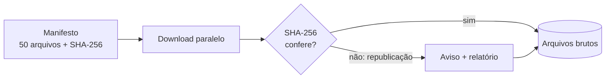

# Os dados

A Polícia Rodoviária Federal (PRF) registra cada acidente nas rodovias federais e publica esses
registros como dados abertos desde 2007. O projeto usa **o conjunto completo**: 50 arquivos, cerca
de 370 MB compactados.

  
2,2 miacidentes

  
424 milcom morto ou ferido grave

  
7.591trechos de 10 km com acidente

  
214BRs diferentes

## 20 anos de acidentes

Com morto ou ferido graveDemais acidentes

<svg viewBox="0 0 720 300" role="img" aria-labelledby="graf-titulo">
<title id="graf-titulo">Acidentes nas rodovias federais por ano, 2007 a 2026, separando os graves</title>
<line x1="52" x2="712" y1="266.0" y2="266.0" stroke="#e8e4f0" stroke-width="1"/>
<text x="44" y="270.0" text-anchor="end" font-size="11" fill="#6b6680">0</text>
<line x1="52" x2="712" y1="203.5" y2="203.5" stroke="#e8e4f0" stroke-width="1"/>
<text x="44" y="207.5" text-anchor="end" font-size="11" fill="#6b6680">50 mil</text>
<line x1="52" x2="712" y1="141.0" y2="141.0" stroke="#e8e4f0" stroke-width="1"/>
<text x="44" y="145.0" text-anchor="end" font-size="11" fill="#6b6680">100 mil</text>
<line x1="52" x2="712" y1="78.5" y2="78.5" stroke="#e8e4f0" stroke-width="1"/>
<text x="44" y="82.5" text-anchor="end" font-size="11" fill="#6b6680">150 mil</text>
<line x1="52" x2="712" y1="16.0" y2="16.0" stroke="#e8e4f0" stroke-width="1"/>
<text x="44" y="20.0" text-anchor="end" font-size="11" fill="#6b6680">200 mil</text>
<line x1="382.0" x2="382.0" y1="16" y2="266" stroke="#b9b3c9" stroke-width="1"/>
<text x="376.0" y="26" text-anchor="end" font-size="11" fill="#4a4560">BR-Brasil</text>
<text x="388.0" y="26" font-size="11" fill="#4a4560">BAT</text>
<g class="coluna"><title>2007: 127.675 acidentes, 21.228 com morto ou ferido grave (17%)</title>
<rect x="52.0" y="16" width="33.0" height="250" fill="transparent"/>
<rect x="57.5" y="239.5" width="22" height="26.5" fill="#5a32c8"/>
<path d="M57.5,237.5 V110.4 Q57.5,106.4 61.5,106.4 H75.5 Q79.5,106.4 79.5,110.4 V237.5 Z" fill="#9d7ce8"/>
</g>
<text x="68.5" y="282" text-anchor="middle" font-size="11" fill="#6b6680">2007</text>
<g class="coluna"><title>2008: 141.043 acidentes, 22.274 com morto ou ferido grave (16%)</title>
<rect x="85.0" y="16" width="33.0" height="250" fill="transparent"/>
<rect x="90.5" y="238.2" width="22" height="27.8" fill="#5a32c8"/>
<path d="M90.5,236.2 V93.7 Q90.5,89.7 94.5,89.7 H108.5 Q112.5,89.7 112.5,93.7 V236.2 Z" fill="#9d7ce8"/>
</g>
<g class="coluna"><title>2009: 158.646 acidentes, 23.761 com morto ou ferido grave (15%)</title>
<rect x="118.0" y="16" width="33.0" height="250" fill="transparent"/>
<rect x="123.5" y="236.3" width="22" height="29.7" fill="#5a32c8"/>
<path d="M123.5,234.3 V71.7 Q123.5,67.7 127.5,67.7 H141.5 Q145.5,67.7 145.5,71.7 V234.3 Z" fill="#9d7ce8"/>
</g>
<text x="134.5" y="282" text-anchor="middle" font-size="11" fill="#6b6680">2009</text>
<g class="coluna"><title>2010: 183.469 acidentes, 26.342 com morto ou ferido grave (14%)</title>
<rect x="151.0" y="16" width="33.0" height="250" fill="transparent"/>
<rect x="156.5" y="233.1" width="22" height="32.9" fill="#5a32c8"/>
<path d="M156.5,231.1 V40.7 Q156.5,36.7 160.5,36.7 H174.5 Q178.5,36.7 178.5,40.7 V231.1 Z" fill="#9d7ce8"/>
</g>
<g class="coluna"><title>2011: 192.326 acidentes, 27.516 com morto ou ferido grave (14%)</title>
<rect x="184.0" y="16" width="33.0" height="250" fill="transparent"/>
<rect x="189.5" y="231.6" width="22" height="34.4" fill="#5a32c8"/>
<path d="M189.5,229.6 V29.6 Q189.5,25.6 193.5,25.6 H207.5 Q211.5,25.6 211.5,29.6 V229.6 Z" fill="#9d7ce8"/>
</g>
<text x="200.5" y="282" text-anchor="middle" font-size="11" fill="#6b6680">2011</text>
<g class="coluna"><title>2012: 184.568 acidentes, 26.593 com morto ou ferido grave (14%)</title>
<rect x="217.0" y="16" width="33.0" height="250" fill="transparent"/>
<rect x="222.5" y="232.8" width="22" height="33.2" fill="#5a32c8"/>
<path d="M222.5,230.8 V39.3 Q222.5,35.3 226.5,35.3 H240.5 Q244.5,35.3 244.5,39.3 V230.8 Z" fill="#9d7ce8"/>
</g>
<g class="coluna"><title>2013: 186.748 acidentes, 25.911 com morto ou ferido grave (14%)</title>
<rect x="250.0" y="16" width="33.0" height="250" fill="transparent"/>
<rect x="255.5" y="233.6" width="22" height="32.4" fill="#5a32c8"/>
<path d="M255.5,231.6 V36.6 Q255.5,32.6 259.5,32.6 H273.5 Q277.5,32.6 277.5,36.6 V231.6 Z" fill="#9d7ce8"/>
</g>
<text x="266.5" y="282" text-anchor="middle" font-size="11" fill="#6b6680">2013</text>
<g class="coluna"><title>2014: 169.201 acidentes, 25.195 com morto ou ferido grave (15%)</title>
<rect x="283.0" y="16" width="33.0" height="250" fill="transparent"/>
<rect x="288.5" y="234.5" width="22" height="31.5" fill="#5a32c8"/>
<path d="M288.5,232.5 V58.5 Q288.5,54.5 292.5,54.5 H306.5 Q310.5,54.5 310.5,58.5 V232.5 Z" fill="#9d7ce8"/>
</g>
<g class="coluna"><title>2015: 122.161 acidentes, 21.853 com morto ou ferido grave (18%)</title>
<rect x="316.0" y="16" width="33.0" height="250" fill="transparent"/>
<rect x="321.5" y="238.7" width="22" height="27.3" fill="#5a32c8"/>
<path d="M321.5,236.7 V117.3 Q321.5,113.3 325.5,113.3 H339.5 Q343.5,113.3 343.5,117.3 V236.7 Z" fill="#9d7ce8"/>
</g>
<text x="332.5" y="282" text-anchor="middle" font-size="11" fill="#6b6680">2015</text>
<g class="coluna"><title>2016: 96.363 acidentes, 21.007 com morto ou ferido grave (22%)</title>
<rect x="349.0" y="16" width="33.0" height="250" fill="transparent"/>
<rect x="354.5" y="239.7" width="22" height="26.3" fill="#5a32c8"/>
<path d="M354.5,237.7 V149.5 Q354.5,145.5 358.5,145.5 H372.5 Q376.5,145.5 376.5,149.5 V237.7 Z" fill="#9d7ce8"/>
</g>
<g class="coluna"><title>2017: 89.567 acidentes, 18.663 com morto ou ferido grave (21%)</title>
<rect x="382.0" y="16" width="33.0" height="250" fill="transparent"/>
<rect x="387.5" y="242.7" width="22" height="23.3" fill="#5a32c8"/>
<path d="M387.5,240.7 V158.0 Q387.5,154.0 391.5,154.0 H405.5 Q409.5,154.0 409.5,158.0 V240.7 Z" fill="#9d7ce8"/>
</g>
<text x="398.5" y="282" text-anchor="middle" font-size="11" fill="#6b6680">2017</text>
<g class="coluna"><title>2018: 69.333 acidentes, 17.535 com morto ou ferido grave (25%)</title>
<rect x="415.0" y="16" width="33.0" height="250" fill="transparent"/>
<rect x="420.5" y="244.1" width="22" height="21.9" fill="#5a32c8"/>
<path d="M420.5,242.1 V183.3 Q420.5,179.3 424.5,179.3 H438.5 Q442.5,179.3 442.5,183.3 V242.1 Z" fill="#9d7ce8"/>
</g>
<g class="coluna"><title>2019: 67.558 acidentes, 18.309 com morto ou ferido grave (27%)</title>
<rect x="448.0" y="16" width="33.0" height="250" fill="transparent"/>
<rect x="453.5" y="243.1" width="22" height="22.9" fill="#5a32c8"/>
<path d="M453.5,241.1 V185.6 Q453.5,181.6 457.5,181.6 H471.5 Q475.5,181.6 475.5,185.6 V241.1 Z" fill="#9d7ce8"/>
</g>
<text x="464.5" y="282" text-anchor="middle" font-size="11" fill="#6b6680">2019</text>
<g class="coluna"><title>2020: 63.585 acidentes, 17.452 com morto ou ferido grave (27%)</title>
<rect x="481.0" y="16" width="33.0" height="250" fill="transparent"/>
<rect x="486.5" y="244.2" width="22" height="21.8" fill="#5a32c8"/>
<path d="M486.5,242.2 V190.5 Q486.5,186.5 490.5,186.5 H504.5 Q508.5,186.5 508.5,190.5 V242.2 Z" fill="#9d7ce8"/>
</g>
<g class="coluna"><title>2021: 64.567 acidentes, 18.118 com morto ou ferido grave (28%)</title>
<rect x="514.0" y="16" width="33.0" height="250" fill="transparent"/>
<rect x="519.5" y="243.4" width="22" height="22.6" fill="#5a32c8"/>
<path d="M519.5,241.4 V189.3 Q519.5,185.3 523.5,185.3 H537.5 Q541.5,185.3 541.5,189.3 V241.4 Z" fill="#9d7ce8"/>
</g>
<text x="530.5" y="282" text-anchor="middle" font-size="11" fill="#6b6680">2021</text>
<g class="coluna"><title>2022: 64.606 acidentes, 18.409 com morto ou ferido grave (28%)</title>
<rect x="547.0" y="16" width="33.0" height="250" fill="transparent"/>
<rect x="552.5" y="243.0" width="22" height="23.0" fill="#5a32c8"/>
<path d="M552.5,241.0 V189.2 Q552.5,185.2 556.5,185.2 H570.5 Q574.5,185.2 574.5,189.2 V241.0 Z" fill="#9d7ce8"/>
</g>
<g class="coluna"><title>2023: 67.766 acidentes, 19.212 com morto ou ferido grave (28%)</title>
<rect x="580.0" y="16" width="33.0" height="250" fill="transparent"/>
<rect x="585.5" y="242.0" width="22" height="24.0" fill="#5a32c8"/>
<path d="M585.5,240.0 V185.3 Q585.5,181.3 589.5,181.3 H603.5 Q607.5,181.3 607.5,185.3 V240.0 Z" fill="#9d7ce8"/>
</g>
<text x="596.5" y="282" text-anchor="middle" font-size="11" fill="#6b6680">2023</text>
<g class="coluna"><title>2024: 73.202 acidentes, 20.644 com morto ou ferido grave (28%)</title>
<rect x="613.0" y="16" width="33.0" height="250" fill="transparent"/>
<rect x="618.5" y="240.2" width="22" height="25.8" fill="#5a32c8"/>
<path d="M618.5,238.2 V178.5 Q618.5,174.5 622.5,174.5 H636.5 Q640.5,174.5 640.5,178.5 V238.2 Z" fill="#9d7ce8"/>
</g>
<g class="coluna"><title>2025: 72.529 acidentes, 20.493 com morto ou ferido grave (28%)</title>
<rect x="646.0" y="16" width="33.0" height="250" fill="transparent"/>
<rect x="651.5" y="240.4" width="22" height="25.6" fill="#5a32c8"/>
<path d="M651.5,238.4 V179.3 Q651.5,175.3 655.5,175.3 H669.5 Q673.5,175.3 673.5,179.3 V238.4 Z" fill="#9d7ce8"/>
</g>
<text x="662.5" y="282" text-anchor="middle" font-size="11" fill="#6b6680">2025</text>
<g class="coluna"><title>2026 (parcial): 48.712 acidentes, 13.653 com morto ou ferido grave (28%)</title>
<rect x="679.0" y="16" width="33.0" height="250" fill="transparent"/>
<rect x="684.5" y="248.9" width="22" height="17.1" fill="#5a32c8"/>
<path d="M684.5,246.9 V209.1 Q684.5,205.1 688.5,205.1 H702.5 Q706.5,205.1 706.5,209.1 V246.9 Z" fill="#9d7ce8"/>
</g>
<text x="695.5" y="282" text-anchor="middle" font-size="11" fill="#6b6680">2026</text>
<text x="200.5" y="19.6" text-anchor="middle" font-size="11" font-weight="600" fill="#3b1f7a">192 mil</text>
<text x="662.5" y="169.3" text-anchor="middle" font-size="11" font-weight="600" fill="#3b1f7a">72 mil</text>
<line x1="52" x2="712" y1="266.0" y2="266.0" stroke="#b9b3c9" stroke-width="1"/>
</svg>

Ver os números
<table><thead><tr><th>Ano</th><th>Acidentes</th><th>Com morto ou ferido grave</th><th>% graves</th></tr></thead><tbody>
<tr><td>2007</td><td>127.675</td><td>21.228</td><td>17%</td></tr>
<tr><td>2008</td><td>141.043</td><td>22.274</td><td>16%</td></tr>
<tr><td>2009</td><td>158.646</td><td>23.761</td><td>15%</td></tr>
<tr><td>2010</td><td>183.469</td><td>26.342</td><td>14%</td></tr>
<tr><td>2011</td><td>192.326</td><td>27.516</td><td>14%</td></tr>
<tr><td>2012</td><td>184.568</td><td>26.593</td><td>14%</td></tr>
<tr><td>2013</td><td>186.748</td><td>25.911</td><td>14%</td></tr>
<tr><td>2014</td><td>169.201</td><td>25.195</td><td>15%</td></tr>
<tr><td>2015</td><td>122.161</td><td>21.853</td><td>18%</td></tr>
<tr><td>2016</td><td>96.363</td><td>21.007</td><td>22%</td></tr>
<tr><td>2017</td><td>89.567</td><td>18.663</td><td>21%</td></tr>
<tr><td>2018</td><td>69.333</td><td>17.535</td><td>25%</td></tr>
<tr><td>2019</td><td>67.558</td><td>18.309</td><td>27%</td></tr>
<tr><td>2020</td><td>63.585</td><td>17.452</td><td>27%</td></tr>
<tr><td>2021</td><td>64.567</td><td>18.118</td><td>28%</td></tr>
<tr><td>2022</td><td>64.606</td><td>18.409</td><td>28%</td></tr>
<tr><td>2023</td><td>67.766</td><td>19.212</td><td>28%</td></tr>
<tr><td>2024</td><td>73.202</td><td>20.644</td><td>28%</td></tr>
<tr><td>2025</td><td>72.529</td><td>20.493</td><td>28%</td></tr>
<tr><td>2026 (parcial)</td><td>48.712</td><td>13.653</td><td>28%</td></tr>
</tbody></table>

Os acidentes registrados caíram de **192 mil em 2011** para cerca de **70 mil por ano** a
partir de 2018. Os graves caíram bem menos: a parte deles subiu de **14% para 28%** dos acidentes. Medir
gravidade, e não quantidade, é o que a pergunta do projeto faz. A queda começa antes da troca de
sistema e ainda não tem explicação verificada; uma hipótese é a mudança no critério de registro.

## Três arquivos por ano

| Arquivo | Uma linha por | Anos |
|---|---|---|
| `datatranAAAA` | acidente: data, BR, km, município, causa, tipo, contagem de vítimas | 2007–2026 |
| `acidentesAAAA` | pessoa envolvida, com o veículo em que estava | 2007–2026 |
| `acidentesAAAA_todas_causas_tipos` | pessoa × causa × tipo de acidente | 2017–2026 |

## Por que estes dados são difíceis

  

    Dois sistemas, dois formatos
    BR-Brasil até 2016 e BAT a partir de 2017: separadores, três formatos
    de data, decimal com ponto ou vírgula, vocabulários diferentes ("Morto" × "Óbito") e 490 mil IDs
    repetidos entre os dois.
  

  

    Republicação sem aviso
    A PRF regrava os arquivos no mesmo endereço e com o mesmo nome, sem
    versão, inclusive de anos fechados: 2024 foi regravado quase dois anos depois.
  

  

    Coordenada só desde 2017
    O BR-Brasil só tem BR e km. No BAT, todo acidente tem latitude e
    longitude, mas de 2019 a 2024 cerca de metade cai num ponto padrão repetido, e não no local
    do acidente.
  

  

    Valores fora do padrão
    km negativo, coordenada fora do limite válido, idade 906, "(null)" como
    texto. Nada é descartado em silêncio: o que não cabe no esquema vai para uma tabela de linhas
    rejeitadas, com o motivo.
  

## Como o dado é adquirido

Um manifesto lista os 50 arquivos, com o identificador no Google Drive e o **SHA-256 de
referência** de cada um. O download roda em paralelo e confere o hash: um arquivo republicado
gera aviso e fica registrado, sem parar o pipeline, e a carga trata a nova versão como um lote
novo daquele ano.

