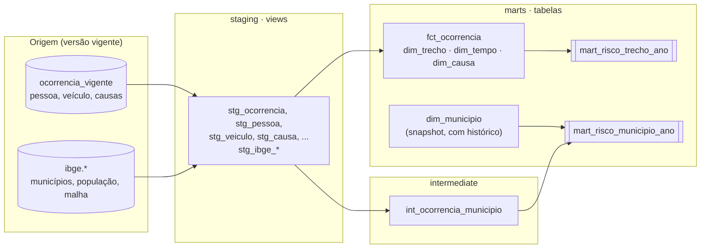
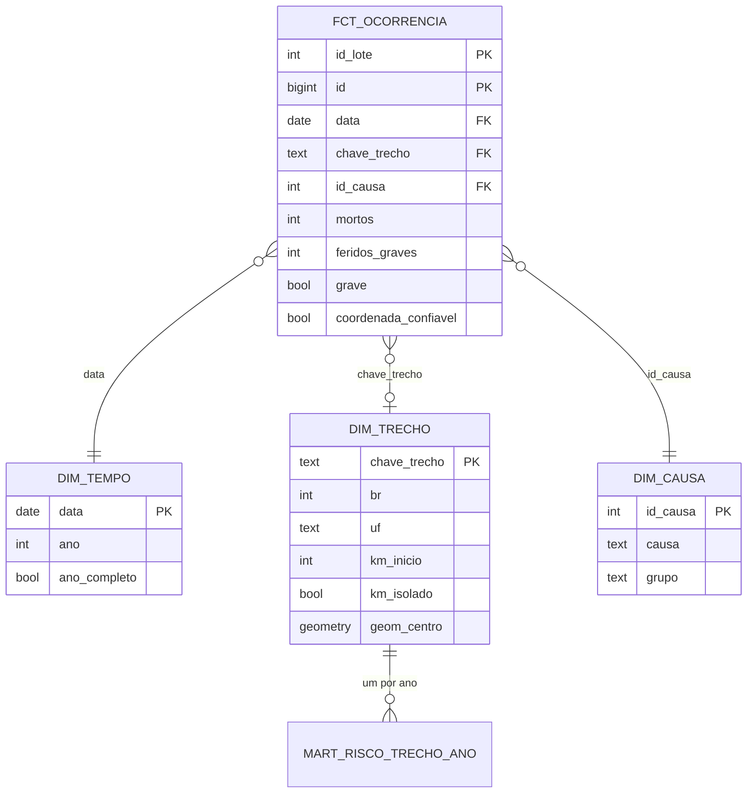

# Modelo analítico

A origem guarda o que a PRF publicou, sem corrigir. Para responder à pergunta, o **dbt**
transforma essa origem em camadas, dentro do próprio PostgreSQL: limpa o vocabulário, monta um
**modelo dimensional** (fato e dimensões) e entrega duas tabelas de consumo, que o painel lê.
Uma segunda fonte, o **IBGE**, liga cada acidente ao seu município.

<div class="numeros" markdown="0">
  <div class="numero"><span class="valor">7 trechos</span><span class="rotulo">entre os 50 mais graves em todos os 19 anos completos</span></div>
  <div class="numero"><span class="valor">105.942</span><span class="rotulo">linhas na resposta: um trecho por ano</span></div>
  <div class="numero"><span class="valor">14</span><span class="rotulo">acidentes em 2,2 mi ficaram sem município</span></div>
  <div class="numero"><span class="valor">79 de 79</span><span class="rotulo">modelos e testes passando no <code>dbt build</code></span></div>
</div>

## A resposta

Em 2025, o pior trecho foi a **BR-101/SC, km 200–210**, com 125 acidentes graves, seguido do km
210–220 da mesma BR (100). Só 135 trechos estiveram alguma vez entre os 50 piores de um ano, e
**7 estiveram em todos os 19 anos** de 2007 a 2025. Esses são os pontos negros que se mantêm, e
não o acaso de um ano:

<ul class="etiquetas" markdown="0">
  <li>BR-101/SC km 200–210</li>
  <li>BR-101/SC km 210–220</li>
  <li>BR-101/ES km 260–270</li>
  <li>BR-316/PI km 0–10</li>
  <li>BR-381/MG km 480–490</li>
  <li>BR-040/MG km 520–530</li>
  <li>BR-277/PR km 0–10</li>
</ul>

A posição no ranking é **relativa ao ano** (`percentil_graves`): o BR-Brasil registrava o dobro de
acidentes do BAT, então um limiar absoluto não serviria para comparar 2010 com 2020.

## As camadas



| Camada | Materialização | Papel |
|---|---|---|
| **staging** | view | Uma por tabela de origem: limpa, sem mudar o nome das colunas |
| **intermediate** | tabela | A ligação acidente → município |
| **marts** | tabela | Fato, dimensões e as duas tabelas de consumo |

## Limpeza: um vocabulário só

Os dois sistemas da PRF escrevem a mesma coisa de jeitos diferentes. No staging isso vira um
vocabulário único, e **"não sei" vira NULL** (`Ignorado`, `Não Informado`, `Inválido`), em vez de
virar uma categoria que se conta.

| O que estava sujo | Depois |
|---|---|
| `Ceu Claro` (753 mil) e `Céu Claro` (408 mil) | `Céu Claro` |
| `Morto`, `Ferido Grave` (BR-Brasil) × `Óbito`, `Lesões Graves` (BAT) | o vocabulário do BAT |
| sexo `M` e `F` ao lado de `Masculino` e `Feminino` | `Masculino`, `Feminino` ou NULL |
| `Motocicletas` e `Motocicleta`, `Micro-ônibus` e `Microônibus` | uma grafia por tipo |
| 101 descrições de causa, várias repetidas com outra grafia | 86 causas, em 6 grupos (na `dim_causa`) |

## O modelo dimensional

Uma estrela com um fato e três dimensões, mais a dimensão de município do IBGE.



| Modelo | Uma linha é | Linhas |
|---|---|---|
| `fct_ocorrencia` | um acidente, na versão vigente de cada ano | 2.243.584 |
| `dim_trecho` | um trecho de 10 km: BR + UF + faixa de km | 7.544 |
| `dim_tempo` | um dia, inclusive os sem acidente | 7.183 |
| `dim_causa` | uma causa como a PRF escreveu | 101 |
| `dim_municipio` | um município **em uma versão** (variação lenta) | uma por versão |
| `mart_risco_trecho_ano` | um trecho por ano | 105.942 |
| `mart_risco_municipio_ano` | um município por ano | 36.454 |

<div class="cartoes" markdown="0">
  <div class="cartao">
    <span class="cartao-titulo">Coordenada padrão marcada</span>
    <span class="cartao-texto">De 2019 a 2024, cerca de metade dos pontos é um ponto padrão repetido.
    O fato marca <code>coordenada_padrao</code> e <code>coordenada_confiavel</code>, e só os pontos
    confiáveis entram no centro do trecho no mapa.</span>
  </div>
  <div class="cartao">
    <span class="cartao-titulo">km digitado errado</span>
    <span class="cartao-texto">A BR-040 em MG tem acidente todo ano até o km 830, e depois um aqui
    e ali até o km 9.960. A <code>dim_trecho</code> marca esses 338 trechos como
    <code>km_isolado</code>: ficam no ranking, mas quase nunca sobem nele.</span>
  </div>
  <div class="cartao">
    <span class="cartao-titulo">Ano incompleto avisado</span>
    <span class="cartao-texto">A PRF publica o ano corrente até o mês anterior. A
    <code>dim_tempo</code> tem <code>ano_completo</code>, para que 2026 não seja comparado com os
    outros anos sem aviso.</span>
  </div>
  <div class="cartao">
    <span class="cartao-titulo">Contrato na tabela de consumo</span>
    <span class="cartao-texto">O <code>mart_risco_trecho_ano</code> tem contrato: se uma coluna mudar
    de nome ou de tipo, o <code>dbt build</code> para antes de criar a tabela, e o painel não quebra
    em silêncio.</span>
  </div>
</div>

## O município de cada acidente

Três APIs públicas do IBGE trazem os 5.571 municípios, a população por ano e o contorno de cada
município. Cada acidente encontra o seu município por um de três caminhos, nesta ordem:

<ol class="fluxo" markdown="0">
  <li><strong>Coordenada</strong>o ponto cai dentro do contorno (PostGIS), de 2017 em diante</li>
  <li><strong>Nome</strong>o nome escrito pela PRF, sem acento, na mesma UF</li>
  <li><strong>Nome antigo</strong>21 municípios que mudaram de nome, como Parati → Paraty</li>
</ol>

| Período | Pela coordenada | Pelo nome | Pelo nome antigo | Sem município |
|---|---|---|---|---|
| 2007–2016 | — | 1.552.262 | 9.889 | **14** |
| 2017–2026 | 680.172 | 1.247 | — | **0** |

O ranking de municípios usa **acidentes graves por 100 mil habitantes**, e só vale para
municípios com pelo menos 10 graves no ano: abaixo disso, um único acidente numa cidade pequena
a põe no topo.

**Histórico do município.** A `dim_municipio` vem de um *snapshot* do dbt: quando o nome ou a UF
mudam, a versão antiga continua, com `valido_de` e `valido_ate`. Testado trocando o nome de
Paraty num banco de teste: a versão antiga ganhou a data de fim, e a nova ficou como a atual.

## Testes de dados

Os testes procuram o que o dado tem de sujo, e não o que o esquema já garante. Os limiares de
distribuição vieram de medir o banco carregado.

| Tipo | Exemplo | O que pega |
|---|---|---|
| Esquema | contrato do mart; `accepted_values` com o vocabulário **depois** da limpeza | coluna renomeada; `Ceu Claro` ou `Morto` que voltou |
| Volume | o fato tem, ano a ano, as linhas que a carga gravou | acidente perdido na transformação |
| Unicidade | um acidente por linha; um trecho por ano | join que duplica |
| Integridade referencial | fato → dimensões; mart → `dim_trecho` | chave sem dimensão |
| Distribuição | graves sem trecho abaixo de 0,5%; graves variando menos de 20% entre anos | km lido errado; ano que mudou de critério |
| Histórico | uma só versão "atual" por município | variação lenta corrompida |

## Consulta otimizada

A consulta mais frequente é a do painel: os 20 trechos com mais acidentes graves num ano. Um
índice em `(ano, graves)`, declarado no próprio modelo do dbt, troca a leitura da tabela inteira
pela leitura de 20 entradas do índice, já na ordem certa.

```sql
SELECT br, uf, km_inicio, graves FROM analitico_marts.mart_risco_trecho_ano
WHERE ano = 2025 AND br <> 0 ORDER BY graves DESC LIMIT 20;
```

| `EXPLAIN (ANALYZE, BUFFERS)` | Antes | Depois |
|---|---|---|
| Plano | `Seq Scan` + `Sort` | `Index Scan Backward` |
| Linhas lidas para devolver 20 | 105.942 | 20 |
| Páginas lidas | 1.496 | 7 |
| Tempo de execução | ~11 ms | **~0,07 ms** |
