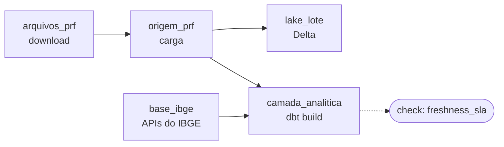

# Orquestração e painel

Depois da primeira carga, a esteira roda sozinha. O **Dagster** agenda as etapas, respeita a
dependência entre elas, tenta de novo quando algo falha, reprocessa anos sob demanda e mede se as
tabelas de consumo estão em dia. No fim da linha, um **painel** responde à pergunta de gestão.

  
03:00a esteira inteira roda todo dia

  
3 tentativaspor etapa, a 30 s, 90 s e 210 s

  
26 hSLA de idade das tabelas de consumo

  
~95 spara reprocessar um ano inteiro

## O grafo

Cada etapa é um *asset* do Dagster, e as dependências são as reais, e não uma fila única: o IBGE
roda em paralelo com a PRF, e o Delta não espera o dbt.

| Job | Quando | O quê |
|---|---|---|
| `esteira` | todo dia às 03:00 | o grafo inteiro, mais a verificação de freshness |
| `verificar_freshness` | de hora em hora | só a verificação, sem reconstruir nada |
| `reprocessar_ano` | sob demanda | backfill, particionado por ano (2007–2026) |

O download baixa de novo o ano corrente e o anterior: a PRF regrava os arquivos no mesmo
endereço, e só assim a carga vê uma republicação. Na primeira execução, isso pegou uma de verdade.

## Retry, demonstrado

Toda etapa tenta de novo até 3 vezes, com espera crescente. Testado derrubando dependências de
propósito.

<ol class="fluxo" markdown="0">
  <li><strong>dbt build</strong>começa</li>
  <li class="alerta"><strong>Banco cai</strong>6 s depois, e volta 20 s depois</li>
  <li><strong>Nova tentativa</strong>30 s após a falha, sozinha</li>
  <li><strong>39 de 39</strong>testes passando; sucesso em 166 s</li>
</ol>

Com a **API do IBGE fora do ar**, as 3 tentativas falham e a etapa falha de vez. A cadeia da PRF
termina normalmente em paralelo, e o dbt **não roda**: as tabelas de consumo ficam como estavam,
em vez de serem reconstruídas com o IBGE pela metade.

## Backfill, demonstrado

Quando muda uma regra de conversão, os anos antigos precisam ser carregados de novo com os mesmos
arquivos. O job `reprocessar_ano` faz isso por ano: recarrega, reescreve a partição Delta e roda o
dbt. Como a origem é insert-only, a recarga vira um lote novo, e o anterior continua no banco.

| Backfill de 2015 e 2016 | 2015 | 2016 |
|---|---|---|
| Lote vigente, antes → depois | 9 → 22 | 10 → 23 |
| Ocorrências vigentes, antes = depois | 122.158 | 96.362 |
| Execução inteira (carga, Delta e dbt) | 96 s | 91 s |

Os totais iguais antes e depois mostram que reprocessar não duplica nada.

## Freshness e SLA

A métrica é a **idade** das duas tabelas que o painel lê, em horas desde o último `dbt build`
sem erro. O **SLA é de 26 h**: a esteira roda uma vez por dia, e as 2 h a mais cobrem as novas
tentativas e uma execução na fila.

| Resultado | Quando |
|---|---|
| Passou | idade dentro do SLA e as duas tabelas existem |
| **ERROR** | idade acima do SLA, ou nenhum `dbt build` terminou ainda |
| WARN | dentro do prazo, mas uma tabela de consumo não existe |

Além da idade, a verificação registra o que explica um atraso: carga concluída que ainda não
chegou às tabelas, quando a PRF foi conferida pela última vez e o acidente mais recente no banco.
Esse último depende da PRF, e não da esteira, por isso fica fora do SLA.

## O painel

Um painel em Streamlit, em `http://localhost:8501`, que lê só as duas tabelas de consumo.

  

    Trechos mais graves
    Os 20 trechos com mais acidentes graves no ano escolhido, e em quantos
    anos cada trecho ficou entre os 50 piores: <strong>se os pontos negros se mantêm</strong>, a
    segunda metade da pergunta.
    lê mart_risco_trecho_ano
  

  

    Municípios mais perigosos
    Acidentes graves por 100 mil habitantes e em número absoluto, com um
    mínimo de graves no ano ajustável, para uma cidade pequena com um acidente não liderar o
    ranking.
    lê mart_risco_municipio_ano
  

