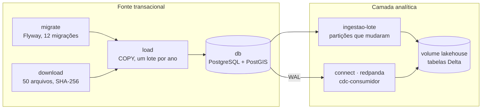
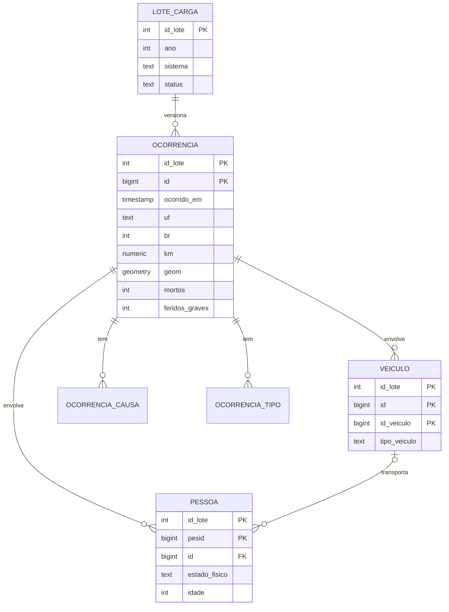

# Pipeline e modelo

Tudo roda em contêineres, orquestrado por um único `docker compose up`. Cada serviço faz uma coisa,
e a ordem entre eles é declarada no próprio Compose: um serviço só começa quando os que ele
depende terminaram sem erro.

## Os serviços

| Etapa | O que faz |
|---|---|
| **Aquisição** | Baixa os arquivos da PRF em paralelo e confere o SHA-256 de cada um contra o manifesto. |
| **Esquema** | O Flyway aplica as migrações versionadas, em ordem; subir de novo só aplica as novas. |
| **Carga** | Um ano por vez, numa transação, com `COPY`. Trata os formatos dos dois sistemas; linha que não cabe vai para `linha_rejeitada` com o motivo (1.275 de 13,2 milhões). |
| **Camada analítica** | Lote incremental e captura de mudanças gravam tabelas Delta. [Detalhes](../camada-analitica/) |
| **Testes** | 119 testes de esquema, volume, distribuição, dado faltante, reprocessamento, lote e CDC. |

## O modelo de dados

O arquivo de pessoas da PRF mistura acidente, veículo e pessoa numa mesma linha. No banco, cada
um vira uma tabela, ligada por chaves estrangeiras, e causas e tipos de acidente viram tabelas de
domínio.

Toda chave começa por `id_lote`: a mesma linha da PRF pode existir em várias versões, e os IDs
repetidos entre os dois sistemas não colidem, porque cada ano pertence a um só sistema.

## Histórico: nada é sobrescrito

Como a PRF regrava arquivos sem aviso, o banco é **insert-only, versionado por lote**. Cada carga
de um ano é um lote; uma republicação entra como um lote novo, e o anterior continua lá. As views
`*_vigente` mostram só a versão mais recente de cada ano, e é delas que as consultas leem.

Um ano só é recarregado quando o SHA-256 de algum arquivo dele muda. Rodar a carga de novo sem
arquivo novo leva segundos e não grava nada.

## O lugar de cada acidente

Desde 2017 todo acidente tem coordenada. A coluna `geom` é um ponto PostGIS gerado da latitude e
da longitude, no referencial oficial do Brasil (SIRGAS 2000), com índice espacial. A consulta típica
de ponto negro, "acidentes graves a menos de 2 km daqui", leva **46 ms com o índice, contra 608 ms**
calculando a distância à mão. Para os anos anteriores, o trecho (BR, UF e km) é o referencial.

## Três tempos em cada dado

| Tempo | Onde fica |
|---|---|
| **Evento:** quando o acidente aconteceu | `ocorrencia.ocorrido_em` |
| **Ingestão:** quando o lote foi carregado | `lote_carga.iniciado_em`, `finalizado_em` |
| **Processamento:** quando chegou à camada analítica | `processado_em` (lote) e `_gravado_em` (CDC) |
